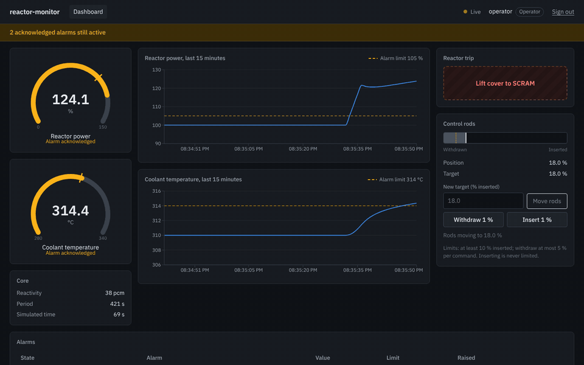
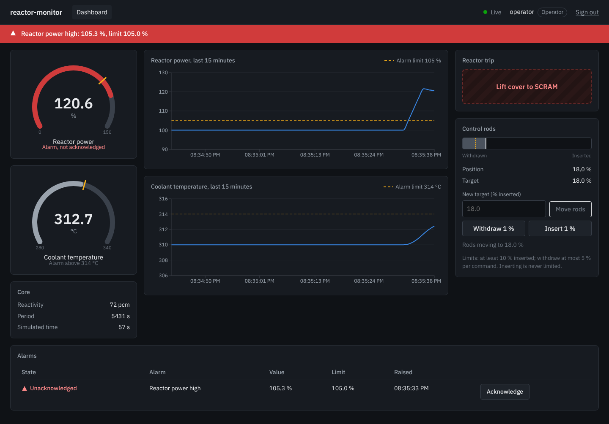
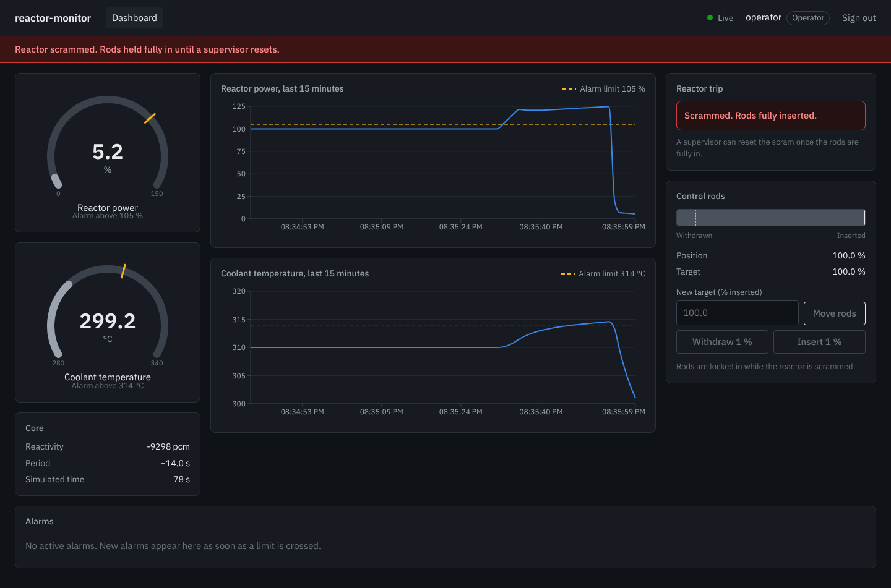
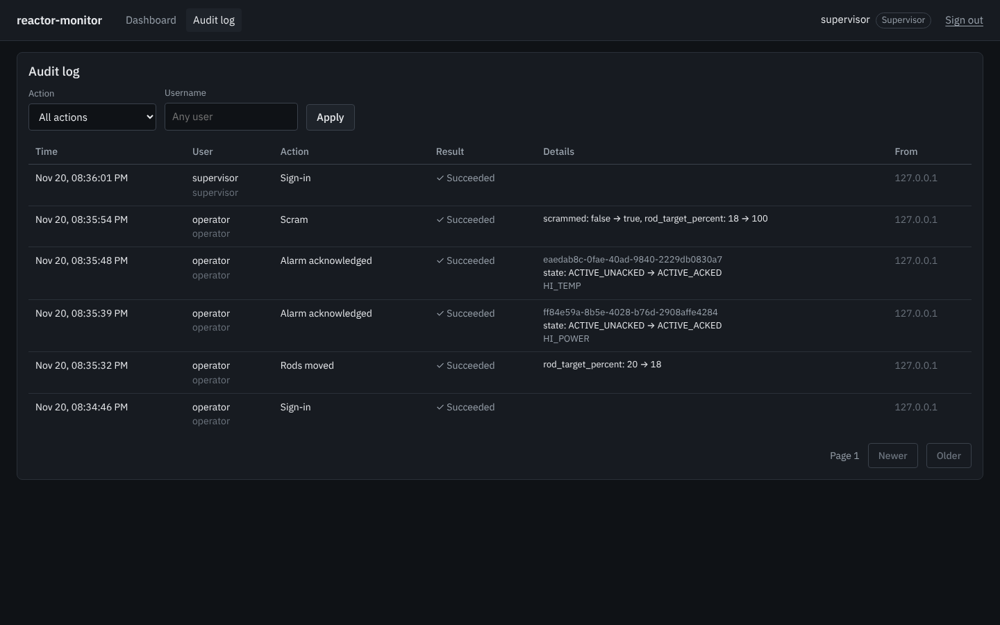
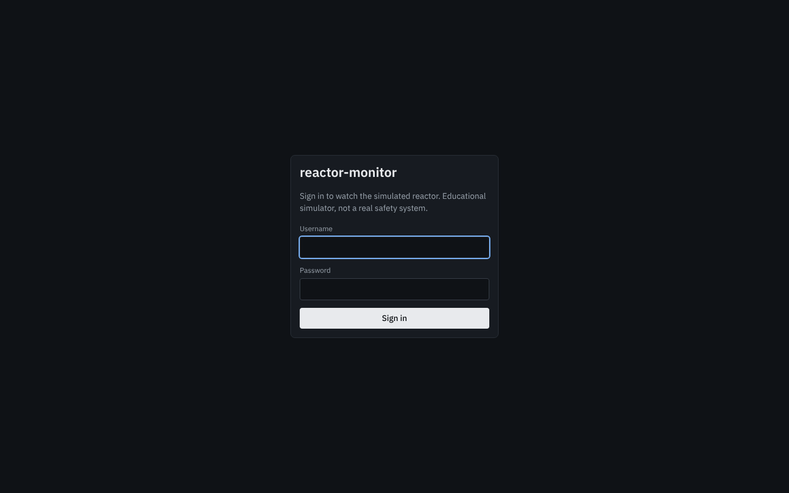
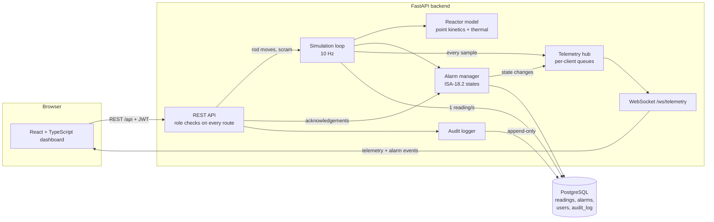

# reactor-monitor

[](https://github.com/gjohal78/reactor-monitor/actions/workflows/ci.yml)
[](https://github.com/gjohal78/reactor-monitor/actions/workflows/ci.yml)

A control-room style monitoring app for a simulated nuclear reactor. A physics model runs
in the backend at 10 Hz and streams live telemetry to a React dashboard over WebSockets.
Operators move control rods, acknowledge alarms and scram the reactor; every action is
checked against the user's role on the server and written to an append-only audit log.

> [!IMPORTANT]
> **Educational model, not a safety system.** The reactor is a simplified textbook model
> (one delayed-neutron group, a lumped thermal model, no decay heat) built for learning
> and as a portfolio project. Nothing here is suitable for operating, monitoring or
> designing a real plant.



*An operator scrams the reactor after acknowledging a high-power and a high-temperature
alarm: the rods drive fully in within 1.5 s and power falls from 124 % to under 6 %.*

## Features

- **Live reactor simulation.** Point kinetics with one delayed-neutron group, S-curve
  control-rod worth, negative temperature feedback and a coolant heat balance, integrated
  with fixed-step RK4. Every parameter is commented with where its value comes from.
- **Real-time dashboard.** Power and temperature gauges with their alarm limits, live
  15-minute trends (Recharts), core readouts and rod position, all over one WebSocket.
- **Process alarms.** High power, high coolant temperature and short reactor period, each
  with a deadband, following the ISA-18.2 alarm life cycle (unacknowledged alarms flash;
  an alarm only clears once it is both back to normal and acknowledged).
- **Reactor control.** Rod moves within a safety envelope, and a guarded SCRAM: lift the
  cover, then press. A supervisor resets the scram once the rods are fully in.
- **Three roles.** Viewer (read only), operator (acknowledge, move rods, scram) and
  supervisor (also change alarm limits, reset the scram, read the audit log), enforced on
  every API route and WebSocket connection.
- **Audit trail.** Every login, control action and refused attempt is recorded with who,
  when, the client IP and the old and new values. The database rejects edits and deletes.
- **Resilient connection.** The dashboard reconnects with backoff if the WebSocket drops,
  refreshes its token first, and reloads recent history so trends have no gap.

| Alarm raised | After the scram |
| --- | --- |
|  |  |

| Audit log (supervisor) | Sign-in |
| --- | --- |
|  |  |

## Quick start

You need [Docker](https://docs.docker.com/get-docker/). Then:

```bash
git clone https://github.com/gjohal78/reactor-monitor.git
cd reactor-monitor
docker compose up
```

Open **http://localhost:5173** and sign in with a demo account:

| Username | Password | Can |
| --- | --- | --- |
| `viewer` | `viewer-demo` | watch everything, change nothing |
| `operator` | `operator-demo` | acknowledge alarms, move rods, scram |
| `supervisor` | `supervisor-demo` | everything above, plus change alarm limits, reset a scram, read the audit log |

Things to try as the operator: set the rod target to **18** and press **Move rods**. Power
passes 105 % within seconds and raises an alarm. Acknowledge it, then lift the cover and
press **SCRAM**. Sign in as the supervisor to reset the scram and read the audit log.

The API docs are at http://localhost:8000/docs (use **Authorize** to sign in).

> [!NOTE]
> The demo accounts exist only because `docker compose up` runs in development mode. The
> backend refuses to create them, and refuses to start with the built-in JWT secret, in any
> other environment. If ports 5173, 8000 or 5432 are taken, copy `.env.example` to `.env`
> and change `FRONTEND_PORT`, `BACKEND_PORT` or `POSTGRES_PORT`.

## Architecture



In development the Vite server proxies `/api` and `/ws` to the backend, so the browser
talks to a single origin.

| Layer | Tech |
| --- | --- |
| Backend | Python 3.12, FastAPI, SQLAlchemy 2, Alembic, PostgreSQL 17, PyJWT, bcrypt |
| Frontend | React 19, TypeScript, Vite, Recharts, React Router |
| Quality | ruff, mypy (strict), pytest + coverage, ESLint (strict type-checked), Vitest, Playwright |
| Delivery | Docker Compose, GitHub Actions |

## Testing

Every push runs the whole suite in GitHub Actions:

| Suite | Tests | What it covers |
| --- | --- | --- |
| Backend (pytest, against PostgreSQL) | **200** | reactor physics, alarm state machine and deadbands, every role on every endpoint, JWT edge cases (expired, forged, `alg: none`, revoked), audit entries and append-only triggers, migrations |
| Frontend (Vitest + Testing Library) | **53** | role-based controls, the two-step SCRAM, reconnect backoff, token refresh, trend buffering |
| End-to-end (Playwright) | **1** | operator signs in, raises a power alarm, acknowledges it, scrams, power drops below 10 % |
| **Total** | **254** | **97 % backend branch coverage** |

CI also runs ruff, strict mypy, ESLint and the production build, and checks the quick
start itself: a fresh checkout, `docker compose up` with no setup, then every demo user
signs in.

To run the checks locally (Python 3.12 and Node 22.12+):

```bash
make install   # backend virtualenv + frontend packages
make lint      # ruff, mypy, eslint, tsc
make test      # pytest + vitest
```

## Design decisions

**Why WebSockets.** The simulator produces a new state ten times a second and alarms can
change at any moment. Polling would either lag or hammer the API, and server-sent events
would need a second channel for anything the client sends. One WebSocket carries
telemetry and alarm events in typed frames. A per-client bounded queue means a slow
browser drops old telemetry rather than slowing the 10 Hz loop, and alarm messages are
never dropped.

**Why roles are enforced on the server.** Anything in the browser can be changed by
whoever is using it, so hiding a button protects nothing. Every route declares the role
it needs through a FastAPI dependency, and the user is reloaded from the database on each
request, so disabling an account or changing a role takes effect on the very next
request, even with a token that hasn't expired. The frontend only hides or disables
controls as a convenience. A test matrix calls every endpoint as every role.

**Why an append-only audit log.** In a control room, "who did what, when" matters most
after something has gone wrong, which is exactly when someone might want to change the
record. The application only ever inserts into `audit_log`, and database triggers reject
`UPDATE`, `DELETE` and `TRUNCATE`, so the history can't be edited even with direct
database access short of dropping the triggers. Refused attempts (wrong passwords, a
viewer trying to scram) are recorded too.

**Why the dashboard is mostly grey.** It follows ISA-101 "high-performance HMI" practice:
normal values are shown in greyscale and colour is reserved for abnormal states, so a red
or amber element always means something needs attention. Status colours always come with
an icon and a label, never colour alone.

**Smaller choices.** The simulator uses fixed-step RK4 because the kinetics equations are
stiff; forward Euler would need a far smaller step for the same accuracy. Synchronous
SQLAlchemy with database work off the event loop is plenty for one reading a second. The
short-period alarm limit (15 s) was chosen after the simulator showed that a 20 s limit
would fire on every normal rod move, which ISA-18.2 calls a nuisance alarm.

## Project layout

```
backend/
  app/sim/        reactor model and the 10 Hz simulation loop
  app/alarms/     limits, deadbands, ISA-18.2 state machine, persistence
  app/auth/       JWT, bcrypt, roles and the FastAPI dependencies that enforce them
  app/audit/      append-only audit log
  app/api/        REST and WebSocket routes
  migrations/     Alembic migrations
  tests/
frontend/
  src/            React app (pages, components, WebSocket hook, API client)
  e2e/            Playwright end-to-end test
.github/workflows/ci.yml
docker-compose.yml
```

Useful commands: `make up` / `make down` (Docker), `make create-user USERNAME=alice
ROLE=supervisor` (prompts for a password), `make migrate`, `make logs`.

## Future work

- **Security hardening:** rate-limit logins, rotate refresh tokens with reuse detection,
  and move tokens into httpOnly cookies.
- **Alarm management:** priorities, shelving and suppression from ISA-18.2, and persisting
  supervisor changes to alarm limits (today they reset on restart).
- **Physics:** six delayed-neutron groups, decay heat and xenon, so post-scram behaviour
  matches a real reactor more closely.
- **Data:** retention and downsampling for readings (about 86,000 rows a day), for example
  with TimescaleDB.
- **Deployment:** a production build behind a reverse proxy, and a hosted demo.
- **Testing:** frontend coverage reporting and more end-to-end scenarios (supervisor reset,
  reconnect after a backend restart).

## License

[MIT](LICENSE) © 2026 Gurman
